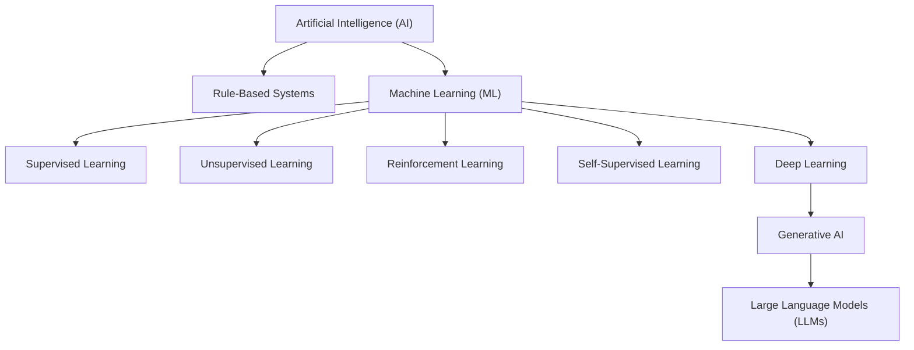
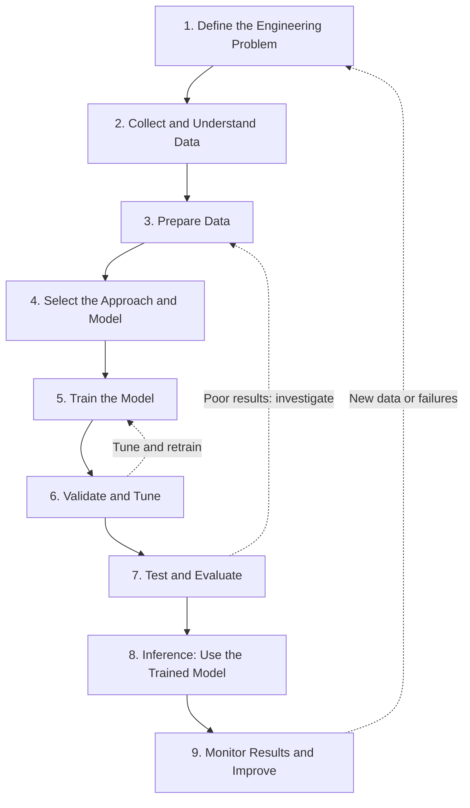

# Week 02 – Final Synthesis: AI/ML Concept Map and ML Lifecycle

## Part 1: AI and Machine Learning Concept Map

### 1. Understanding the AI landscape

Artificial Intelligence (AI) is the broad field of building systems that perform tasks requiring intelligent behaviour. Machine Learning (ML) is a part of AI in which systems learn patterns from data.

### 2. What the concepts mean

- **AI:** The broad field of systems that perform tasks associated with intelligent behaviour.
- **Rule-based systems:** Follow explicitly written rules. They do not automatically learn those rules from examples.
- **Machine learning:** Learns patterns from data to make predictions or support decisions.
- **Deep learning:** Uses neural networks with multiple layers to learn complex patterns.
- **Generative AI:** Generates new content, such as text, images, or code.
- **LLMs:** Large language models trained to process and generate language.

The diagram is a simplified map. Deep learning is an ML approach, while generative AI describes a type of capability. These concepts are related, but they do not all represent the same kind of category.

## Part 2: Learning Paradigms vs. ML Task Types

Learning paradigms explain **how a model learns**. Task types explain **what the model is expected to do**.

| Learning paradigm | How it learns | Example |
|---|---|---|
| Supervised learning | Learns from labelled examples | Predict whether a chip will pass or fail |
| Unsupervised learning | Finds patterns in data without supplied target labels | Group similar chip designs |
| Reinforcement learning | Learns through actions and rewards | Explore chip placement choices |
| Self-supervised learning | Creates learning signals from the data itself | Learn representations from unlabelled data |

| ML task type | Expected output | Example |
|---|---|---|
| Classification | A category or class | Pass or fail |
| Regression | A numerical value | Predict chip temperature |
| Clustering | Groups of similar samples | Group similar design patterns |
| Anomaly detection | An indication or score of unusual behaviour | Flag an unusual timing report |
| Dimensionality reduction | A lower-dimensional representation | Simplify complex design data for analysis |
| Ranking | An ordered list of candidates | Rank placement options by predicted quality |

A paradigm and a task type are not interchangeable. For example, supervised learning can be used for classification or regression. The correct choice depends on the engineering problem, available data, and desired output.

## Part 3: Machine Learning Lifecycle Map

A typical ML project follows these stages. In practice, engineers may return to earlier stages when evaluation reveals a problem.

### What happens at each stage?

1. **Define the problem:** Identify the engineering goal, constraints, and measurable success criteria.
2. **Collect and understand data:** Identify samples, features, labels, data sources, and data-quality issues.
3. **Prepare data:** Clean the data, handle missing values, encode or scale features when needed, and create suitable data splits.
4. **Select an approach:** Choose a learning paradigm and a suitable model based on the problem.
5. **Train:** Use training data to learn model parameters.
6. **Validate and tune:** Use validation data to compare model settings and select a suitable model.
7. **Test and evaluate:** Evaluate the selected model on held-out test data and measure its performance and generalisation.
8. **Inference:** Give new inputs to the trained model to obtain predictions.
9. **Monitor and improve:** Check real-world performance, investigate errors, and retrain or redesign when necessary.

### Important distinction

- **Training** is the process of learning model parameters from data.
- **Inference** is using the trained model to produce an output for new input data.
- **Evaluation** measures how well the model performs against defined criteria.

## Part 4: Three Ways an ML Project Can Fail

### Failure 1: Poor-quality or unrepresentative data

**Example:** A defect-detection model is trained using images from only one manufacturing line, but it is later used on another line with different lighting and equipment.

**Why it fails:** The training data may not represent the conditions encountered in practice.

**Mitigation:** Collect representative data, inspect performance across different conditions, and monitor results after deployment.

### Failure 2: Data leakage

**Example:** Information that would only become available after a chip has failed is accidentally included as a feature during training.

**Why it fails:** The model may appear accurate during testing because it receives information that would not be available when making a real prediction.

**Mitigation:** Separate data according to the real prediction scenario, inspect features carefully, and keep test data independent of model training and tuning.

### Failure 3: Overfitting

**Example:** A model performs extremely well on training data but performs poorly on new chip designs.

**Why it fails:** The model may have learned details specific to its training examples rather than general patterns.

**Mitigation:** Use suitable validation data, simplify or regularise the model where appropriate, and evaluate on genuinely unseen examples.

## Part 5: Semiconductor Application — ML-Assisted Chip Floorplanning

### Engineering problem

Physical-design engineers must arrange chip
